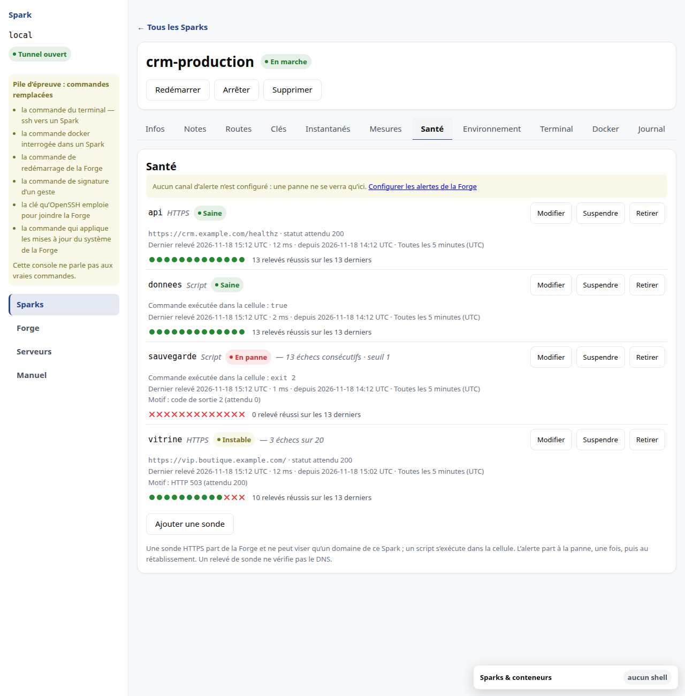
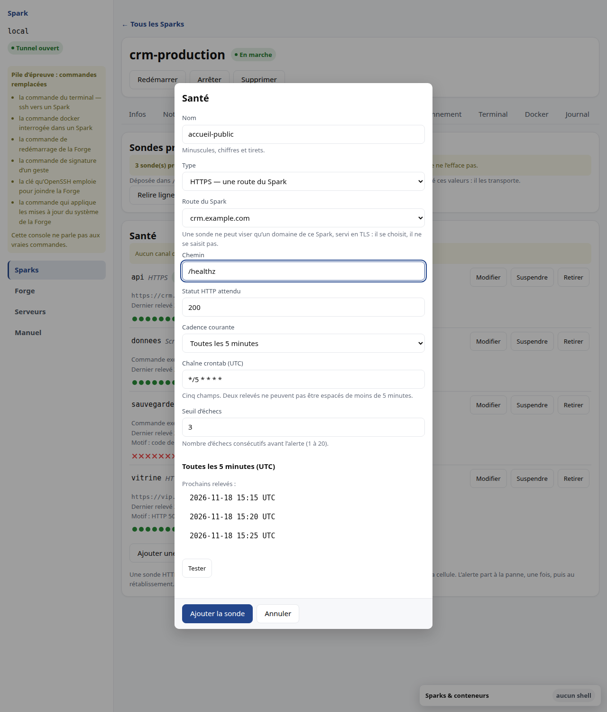
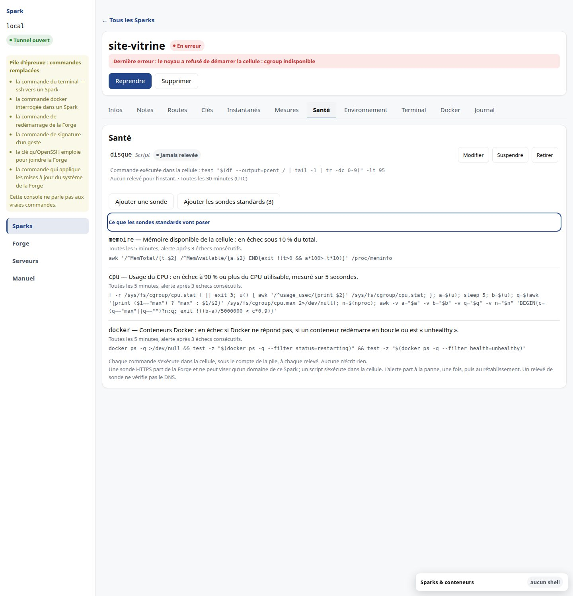
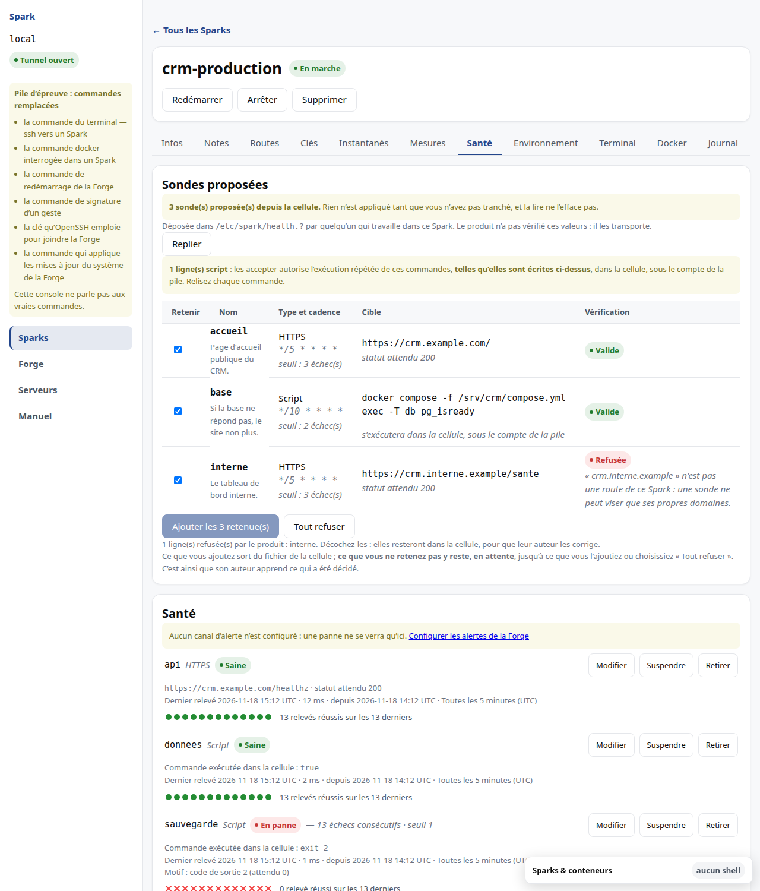

# M14 · Surveiller la santé d'un Spark

Un Spark qui tourne n'est pas forcément un Spark qui sert. L'onglet **Santé** du
dossier d'un Spark pose des **sondes** : à intervalle régulier, la Forge vérifie
qu'une page répond, ou qu'une commande réussit dans la cellule, et vous le dit.

## Ce que fait une sonde

Une sonde a un nom, une cadence, un seuil et une vérification. Il y en a deux
sortes :

- **HTTPS** — la Forge demande une page d'une route du Spark et compare le code
  de statut à celui que vous attendez (200 par défaut). Le domaine doit être une
  route déclarée de ce Spark, en TLS, sans joker : le menu ne propose que celles-là.
  Le certificat est vérifié, et seule la ligne de statut est lue — le contenu de
  la page n'est ni gardé ni examiné.
- **Script** — une commande exécutée dans la cellule, sous le compte de la pile
  (`root`, ou le compte sans privilège qui porte Docker quand la pile est
  « rootless »). Seul son code de sortie est gardé, jamais ce qu'elle affiche. Une
  commande Docker de la pile — `docker compose … exec -T db pg_isready` — y a sa place.

Ce que la sonde ne fait pas : elle n'enregistre ni le corps d'une réponse ni la
sortie d'un script, et elle ne redémarre rien.

## Lire la liste



Chaque ligne dit, sans que la couleur porte seule le message :

| État | Ce que cela veut dire |
|---|---|
| **Saine** | le dernier relevé a réussi |
| **Instable** | des relevés ont échoué, sans atteindre le seuil : « 2 échecs sur 3 » |
| **En panne** | le seuil d'échecs consécutifs est atteint : « 5 échecs consécutifs · seuil 3 » |
| **Arrêtée** | le Spark est arrêté ; la sonde ne relève rien et ne conclut rien |

À côté de l'état : le dernier relevé, sa durée, la cadence en clair, et une
**frise** des derniers résultats — un rond plein pour un succès, une croix pour un
échec, avec un équivalent en texte. Un script montre sa commande exacte ; une
sonde HTTPS, son adresse.

Le **seuil d'échecs** se règle par sonde : une sonde de base de données peut
passer en panne dès le premier échec (seuil 1), une page lente tolérer 20 échecs.

## Quand l'alerte part

Une alerte part par le canal hors bande de la Forge (voir [M12](M12-annexes.md))
**au passage** d'un état à l'autre — quand la sonde tombe en panne, puis quand
elle revient — et non à chaque relevé échoué. Une panne qui dure ne vous envoie
donc pas un message toutes les cinq minutes.

Si la Forge n'a aucun canal d'alerte configuré, l'onglet le dit en haut :
« Aucun canal d'alerte n'est configuré : une panne ne se verra qu'ici ».

## Ajouter une sonde

*Ajouter une sonde* ouvre une fenêtre. Choisissez le type, puis :

- pour **HTTPS** : la route, le chemin (`/healthz`), le statut attendu ;
- pour **Script** : la commande, et le code de sortie attendu (0 par défaut) ;
- pour les deux : la **cadence** — un menu de valeurs courantes (toutes les 5, 10,
  15, 30 minutes, toutes les heures, toutes les 6 heures) qui écrit la chaîne
  crontab, ou « Personnalisée » pour la taper vous-même — et le **seuil d'échecs**.

La cadence se lit en UTC et ne peut pas être plus serrée que **5 minutes** : en
dessous, la fenêtre dit pourquoi et le bouton d'enregistrement reste inactif.
Pendant que vous tapez, une phrase redit la cadence en clair, et les prochains
relevés sont listés.



Le nom d'une sonde ne change pas après sa création : retirez-la et posez-en une
autre.

### Essayer avant d'enregistrer

*Tester* exécute la sonde une fois, tout de suite, et montre le résultat dans la
fenêtre : « L'essai a réussi » ou « L'essai a échoué », avec le code de sortie ou le
statut obtenu. **Un essai n'enregistre rien et n'envoie aucune alerte** — la
fenêtre le redit. C'est l'occasion de vérifier une commande avant de la planifier.

## Ajouter les sondes standards

Le **disque**, la **mémoire**, l'**usage du CPU** et la **santé des conteneurs Docker** se surveillent presque partout de la même façon.
Le bouton **Ajouter les sondes standards (N)**, à côté d'*Ajouter une sonde*, les pose d'un geste — **celles qui manquent**, reconnues
**par leur nom** : `disque`, `memoire`, `cpu`, `docker`.



- **Le compte dit ce qui sera ajouté.** « (3) » signifie que trois sondes manquent. Quand il n'en manque plus, le bouton disparaît et la
  section l'écrit.
- **Lisez avant de cliquer.** Sous le bouton, *Ce que les sondes standards vont poser* montre chaque sonde avec sa **commande exacte**, sa
  cadence et son seuil. Chaque commande s'exécutera dans la cellule à chaque relevé, sous le compte de la pile : c'est vous qui l'autorisez.
  Aucune n'écrit quoi que ce soit.
- **Une sonde existante n'est jamais modifiée.** Si vous avez déjà une sonde nommée `disque`, avec vos propres réglages, elle reste telle
  quelle : le bouton ne pose que les autres, et la phrase de confirmation dit lesquelles étaient déjà là.
- **`docker` n'est offerte que si Docker est activé** sur le Spark. Sinon elle est écrite comme indisponible, avec sa raison.
- Un Spark **protégé** refuse : levez la protection d'abord.

| Sonde | Cadence | Alerte après | Échoue quand |
|---|---|---|---|
| `disque` | toutes les 15 minutes | 2 échecs | le disque de la cellule est occupé à 90 % ou plus |
| `memoire` | toutes les 5 minutes | 3 échecs | la mémoire disponible est sous 10 % du total |
| `cpu` | toutes les 5 minutes | 3 échecs | la cellule utilise 90 % ou plus du CPU dont elle dispose, sur 5 secondes |
| `docker` | toutes les 5 minutes | 3 échecs | Docker ne répond pas, un conteneur redémarre en boucle, ou un conteneur est `unhealthy` |

Ce sont des valeurs de départ : chaque sonde posée se **modifie** ensuite comme n'importe quelle autre. Une cellule **sans plafond de
CPU** est comparée à tous les cœurs qu'elle voit : la sonde `cpu` ne se déclenche alors presque jamais — elle dit « ce Spark mange toute
la machine », pas « il travaille ». Une sonde de CPU qui ne peut pas mesurer (cgroup illisible) **échoue** plutôt que de passer en silence.

## Suspendre, reprendre, retirer

- *Suspendre* arrête les relevés sans perdre la sonde ni son historique ; *Reprendre*
  les relance.
- *Retirer* demande une confirmation dans le flux, et supprime la sonde avec son
  historique.

Un **Spark protégé** refuse ces écritures — ajouter, modifier, suspendre, retirer,
tester — et la fenêtre le dit. Ses sondes déjà posées continuent pourtant de
relever : protéger un Spark ne l'empêche pas d'être surveillé.

## Proposer des sondes depuis la cellule : `health.?`

Comme les autres réglages, les sondes peuvent être **suggérées depuis la cellule**
(voir [M8](M8-exploiter.md)) : la cellule écrit `/etc/spark/health.?`, une sonde
par ligne,

```
<nom> <type> <cadence en 5 champs> <seuil> <attendu> <cible…>
accueil   http    */5 * * * *  3  200  crm.example.com /
base      script  */5 * * * *  1  0    docker compose -f /srv/crm/compose.yml exec -T db pg_isready
```

et l'onglet affiche une bannière : « 3 sonde(s) proposée(s) ». **Une proposition
ne pose rien.** Elle s'ouvre en tableau, ligne par ligne, avec :

- la commande exacte d'un script, et le compte sous lequel elle s'exécutera ;
- le **verdict du produit** pour chaque ligne — par exemple « `crm.interne.example`
  n'est pas une route de ce Spark » ;
- une case par ligne pour garder ou écarter.



*Ajouter* reste inactif tant qu'une ligne retenue est refusée : décochez-la, ou
corrigez-la dans la cellule. Les lignes écartées **restent dans la cellule**, en
attente : la proposition revient avec elles seules, marquée « appliquée en partie ».
Un refus du produit ne vide jamais le fichier.

Le fichier `/etc/spark/health` que la Forge régénère montre l'état de chaque
sonde au dernier relevé — c'est un instantané, jamais la sortie d'un script.

## Ce qui est garanti, et ce qui ne l'est pas

- La Forge relève **depuis elle-même** : une page injoignable de l'extérieur
  mais servie localement paraîtra saine. La sonde dit que Caddy et le Spark
  répondent, pas que le DNS public est juste (la page de la route le vérifie
  séparément — voir [M7](M7-domaine.md)).
- Deux relevés ne sont jamais espacés de moins de 5 minutes : la sonde détecte
  une panne en quelques minutes, pas en quelques secondes.
- Une alerte n'est annoncée que si un canal hors bande est configuré et joignable.
