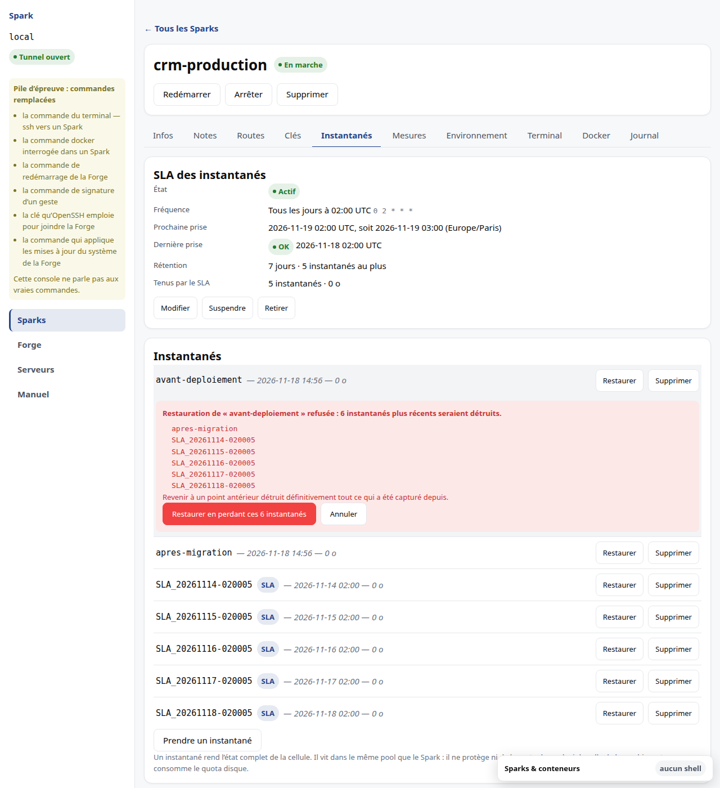
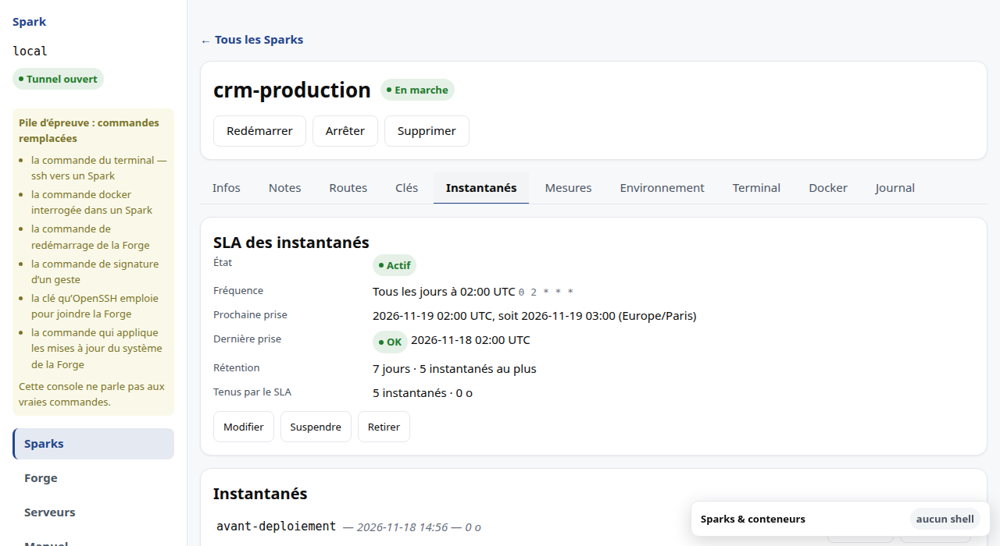
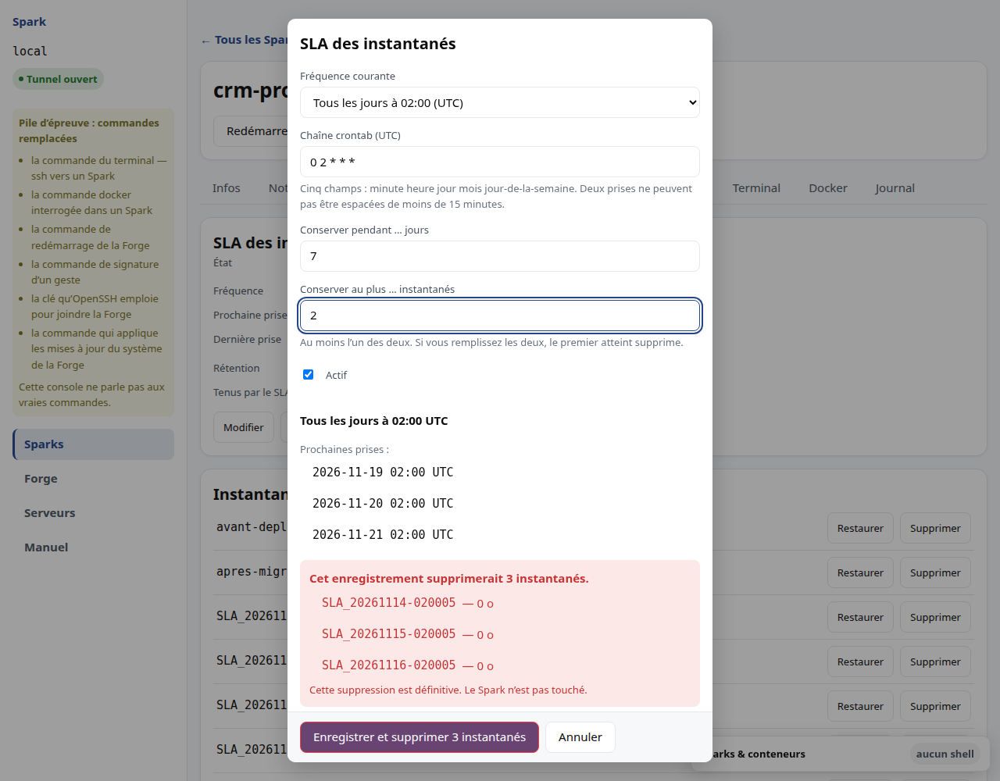
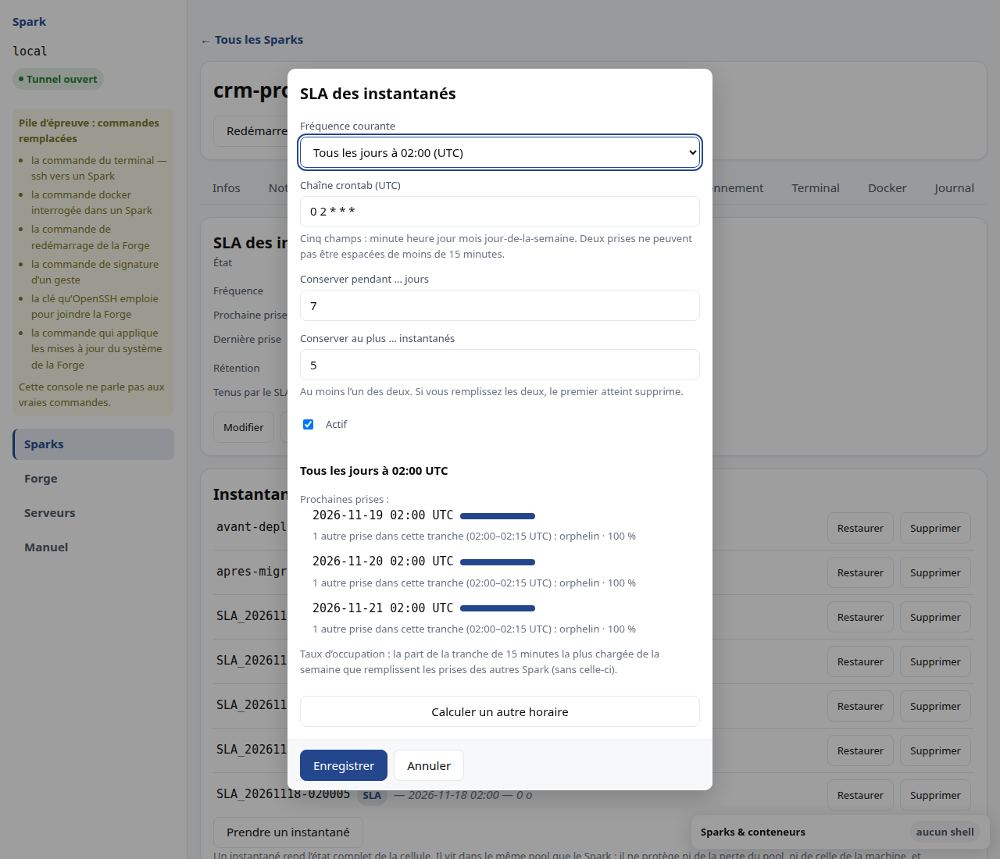
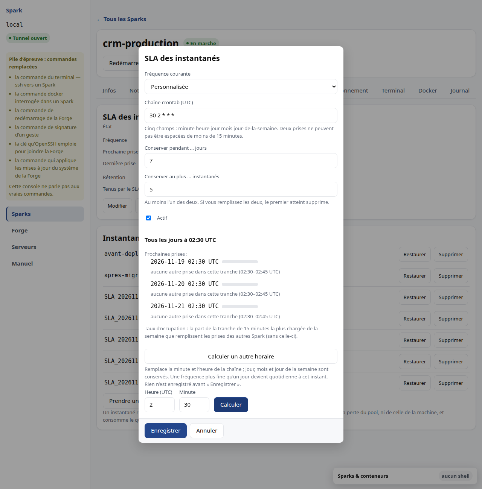

# M9 · Instantanés et sauvegarde

## Ce qu'un instantané est

Un retour arrière de la **cellule entière**, pris sans interrompre son exécution.
Il sert à revenir avant un déploiement raté.

## Ce qu'il n'est pas

**Ce n'est pas une sauvegarde.** Il vit dans le même pool de stockage que le
Spark : il ne protège ni de la perte de ce pool, ni de celle de la machine.

Deux conséquences à ne pas perdre de vue :

- **un instantané consomme votre quota disque.** Il coûte d'abord zéro — il
  partage tous ses blocs avec le Spark — puis grossit à mesure que le Spark s'en
  écarte. Un Spark qui en accumule voit son espace diminuer sans qu'aucun fichier
  n'ait été ajouté ;
- le système de fichiers est figé à un instant qui ne correspond à aucun point de
  cohérence applicatif. Une base de données en cours d'écriture se retrouvera, à
  la restauration, dans l'état d'un arrêt brutal.

Vos sauvegardes applicatives restent nécessaires, et ailleurs.

## Restaurer

La restauration **écrase l'état courant**. Elle demande donc une confirmation qui
nomme ce qui sera perdu.

Revenir à un point ancien détruirait tout ce qui a été capturé depuis. Le produit
**refuse** plutôt que de le faire en silence, et **nomme les instantanés qui
bloquent**.

L'acceptation de leur perte n'est offerte **qu'après ce refus**, jamais avant.
C'est délibéré : une case à cocher présentée d'avance serait cochée par habitude,
et vous perdriez des instantanés que vous n'avez jamais regardés. Le refus est ce
qui rend la perte visible.

## Supprimer un instantané

Irréversible. La confirmation nomme l'instantané.

## Le SLA : des instantanés pris tout seuls

Dans l'onglet **Instantanés**, la section **SLA des instantanés** programme une prise
automatique et dit combien de temps on garde ce qu'elle produit.

### Programmer

**Programmer** (ou **Modifier**) ouvre une fenêtre à quatre réglages :

- **La fréquence.** Un menu propose les fréquences courantes — toutes les heures, toutes les
  6 heures, tous les jours à 02:00, deux fois par jour, les jours ouvrés, le dimanche, le 1er
  du mois. Choisir une fréquence **écrit la chaîne** dans le champ voisin ; vous pouvez la
  modifier à la main, et le menu se repositionne sur « Personnalisée » si elle n'est aucune des
  fréquences courantes. C'est une chaîne crontab à cinq champs (`minute heure jour mois
  jour-de-la-semaine`), **lue en UTC**. Deux prises ne peuvent pas être espacées de moins de
  15 minutes ; une chaîne plus serrée est refusée avec sa raison.
- **La rétention**, par ancienneté (**jours**) et/ou par nombre (**instantanés au plus**). Il en
  faut **au moins une** : sans elle, les instantanés s'accumuleraient dans le quota du Spark.
  Si vous remplissez les deux, le premier atteint supprime.
- **Actif** : décoché, la politique est enregistrée mais ne prend rien.

Sous les champs, **l'aperçu** dit la fréquence en clair, les trois prochaines prises, et — quand
la rétention saisie **supprimerait** des instantanés qui existent déjà — **les nomme tous**.

### Où tombent les prises : le taux d'occupation

Sous chacune des trois prochaines prises, l'aperçu dessine une **barre** et dit en toutes lettres ce qu'elle
représente : combien **d'autres SLA** — ceux des autres Sparks, **pas celui-ci** — prennent leur instantané dans
**la même tranche de 15 minutes**, et lesquels. Prendre tous au même moment fait travailler le disque d'un coup : cet
aperçu sert à choisir un moment plus calme.

Le **taux** est relatif : **100 %** veut dire « aussi chargée que la tranche la plus chargée de la semaine », pas
« saturée » ; **0 %**, « aucune autre prise ». Il compte des **débuts de prise**, pas leur durée, que la Forge ne
connaît pas. Un SLA **suspendu** ne prend rien et ne compte pas. La couleur ne dit rien seule : le nombre et les noms
sont écrits.

Pour essayer un autre moment, **Calculer un autre horaire** ouvre deux champs, **Heure** et **Minute** (en UTC). *Calculer*
**remplace la minute et l'heure** de la chaîne — le jour, le mois et le jour de la semaine sont conservés — et
l'aperçu se recalcule aussitôt, avec la charge de chaque prise. Une fréquence plus fine qu'un jour, comme
`*/15 * * * *`, devient **quotidienne à l'heure choisie**. Vous pouvez recalculer autant de fois que vous voulez :
**rien n'est enregistré** avant *Enregistrer*.

Dans le cas d'une suppression, le bouton dit **Enregistrer et supprimer 3 instantanés** et prend la couleur de
l'alerte : la suppression est définitive. Sans suppression, il dit simplement **Enregistrer**.

### Ce que le SLA supprime, et ce qu'il ne supprime jamais

- Il ne supprime que **ses propres instantanés** — ceux qui portent le badge **SLA**. Un
  instantané que vous avez pris à la main n'est **jamais** supprimé par le SLA.
- Il garde **toujours le plus récent**, quelle que soit la rétention : même une rétention d'un
  jour, après trois jours sans prise, ne laisse pas un Spark sans point de retour.
- Les instantanés pris par le SLA s'appellent `SLA_AAAAMMJJ-HHMMSS` (en UTC). Ce préfixe est
  réservé : un instantané manuel ne peut pas le porter.
- Ils comptent dans le **quota disque** du Spark, comme les autres.

### Suspendre, reprendre, retirer

- **Suspendre** gèle la politique **entièrement** : plus de prise, et plus de suppression. Une
  pause ne détruit rien. **Reprendre** repart d'aujourd'hui : les prises manquées pendant la
  pause ne sont pas rattrapées.
- **Retirer** supprime la politique, après une confirmation. **Les instantanés déjà pris
  restent** ; ils se suppriment à la main.

### Quand quelque chose ne va pas

- La section affiche la **dernière prise** et son résultat. Un échec s'écrit en toutes lettres,
  avec la raison que le serveur donne.
- Si `sparkd` a été arrêté, **une seule** prise est rattrapée au redémarrage (et le journal dit
  combien d'occurrences ont été manquées) ; après un échec, la prise est reprise trois fois,
  à cinq minutes d'écart.
- Un **Spark protégé** refuse qu'on règle son SLA, comme toute écriture. Le refus s'affiche dans
  la fenêtre, et votre saisie n'est pas perdue. La politique déjà posée, elle, continue d'agir.
- Pour l'instant, un échec de SLA **n'envoie pas d'alerte hors bande** : il se lit ici et au
  Journal.

